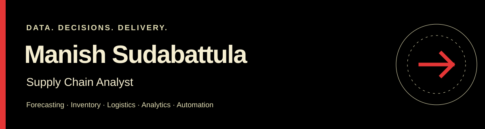

# Hi, I’m Manish Sudabattula

**Supply Chain Analyst · Analytics & Automation · Tampa, Florida**

I connect supply chain data to better planning, smarter inventory, and more reliable deliveries. 
**4+ years of experience** in retail and e-commerce operations, backed by an **M.S. in Computer Science**.

[LinkedIn](https://www.linkedin.com/in/manishsudabattula02) · [Email](mailto:sudabattulam26@gmail.com)

---

## My profile at a glance

- **Operational focus:** demand forecasting, S&OP, procurement, replenishment, inventory, and logistics.
- **Technical strengths:** SQL, Python, R, Power BI, Tableau, Advanced Excel, and ERP/WMS systems.
- **Business-to-technology bridge:** translating operational needs into dashboards, automation, requirements, and process improvements.
- **On GitHub:** public work spanning analytics, applied AI research, product development, and human-centered design.

## Professional impact

| Inventory turnover | Forecasting accuracy | Stockouts | Delivery reliability |
| :---: | :---: | :---: | :---: |
| **18% improvement** | **22% improvement** | **25% reduction** | **98% OTIF** |

*Selected results from my professional experience at FedEx, as reported in my résumé. These are workplace outcomes, separate from the GitHub projects below.*

## Experience

### FedEx — Supply Chain Analyst
**Jan 2025 – Present · Miami, Florida, USA**

- Improved inventory turnover by **18%** using SAP S/4HANA, SAP EWM, and Oracle ERP.
- Built Power BI and Tableau dashboards for procurement, demand, and logistics KPIs, improving forecasting accuracy by **22%**.
- Automated SQL/PL/SQL replenishment across **30+ warehouses**, reducing stockouts by **25%**.
- Supported S&OP alignment and **98% on-time, in-full delivery**; reporting automation reduced manual effort by **40%**.
- Applied Lean Six Sigma root cause analysis and translated business needs into BRDs, FRDs, and UML diagrams.

### Next Shippment LLP — Supply Chain Analyst
**Jan 2021 – Jul 2023 · Mumbai, India**

- Developed R and Excel forecasting models, improving accuracy by **20%** across **five distribution centers**.
- Implemented replenishment strategies that reduced stockouts by **15%**.
- Automated route planning with SAP TM, reducing delivery costs and lead time variance by **12%**.
- Integrated vendor and shipment data using PostgreSQL, reducing delayed purchase order fulfillment by **17%**.

## Explore my GitHub work

**Start here:** [All public repositories →](https://github.com/ManishSudabattula?tab=repositories)

These projects show my technical and product interests alongside my supply chain career.

| Repository | What you can explore |
| --- | --- |
| **[Personal Portfolio](https://github.com/ManishSudabattula/portfolio-me)** | My professional story, experience, and work highlights in a responsive, accessible HTML/CSS/JavaScript site. [Visit the live portfolio ↗](https://manishsudabattula.github.io/portfolio-me/) |
| **[Adversarial Safenet](https://github.com/ManishSudabattula/adversarial-safenet)** | Collaborative NLP research at USF exploring GPT-2 adversarial testing, influence tracing, and iterative dataset refinement. |
| **[Hearth — Household Money Manager](https://github.com/ManishSudabattula/manage-money)** | A household finance application for accounts, income, expenses, saving opportunities, and investment goals, with browser-local storage and optional Supabase sync. |
| **[Enhancing BullsConnect](https://github.com/ManishSudabattula/enhancing-bulls-connect)** | A collaborative human-centered design project at USF focused on student engagement, responsive interfaces, and usability evaluation. |

## Skills & tools

| Area | Tools and capabilities |
| --- | --- |
| **Planning & improvement** | Demand forecasting, S&OP, replenishment planning, inventory management, procurement, strategic sourcing, logistics, Lean Six Sigma |
| **Analytics & programming** | SQL, PL/SQL, Python, R, PySpark, Power BI, Tableau, Advanced Excel, VBA |
| **Databases** | Oracle, SQL Server, PostgreSQL, BigQuery, MongoDB |
| **Enterprise systems** | SAP S/4HANA, SAP ERP, SAP IBP, SD, MM, EWM, TM, LE, Oracle ERP, Manhattan WMS |
| **Business analysis & delivery** | BRDs, FRDs, UML, use case modeling, gap and impact analysis, Jira, Agile, Git, Azure DevOps, project planning |

## Education & certification

- **Master of Science, Computer Science** — University of South Florida, Tampa, Florida
- **B. Tech in Computer Science** — GITAM University, Hyderabad, India
- **Certified Six Sigma Green Belt**

---

### Let’s move things forward.

For supply chain analytics, planning, business analysis, or operations opportunities: 
**[sudabattulam26@gmail.com](mailto:sudabattulam26@gmail.com)**

[Explore my GitHub](https://github.com/ManishSudabattula?tab=repositories) · [Portfolio](https://manishsudabattula.github.io/portfolio-me/) · [LinkedIn](https://www.linkedin.com/in/manishsudabattula02) · [Résumé](https://manishsudabattula.github.io/portfolio-me/assets/manish-sudabattula-resume.docx)

